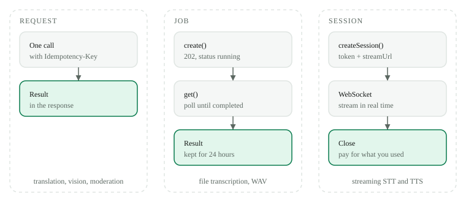

# AI services overview

All AI services are called from your backend with `CloudClient` and billed from the project's credit balance. Audio, images and text are processed on dTelecom's own infrastructure. The media you send is not kept after processing; results stay available for 24 hours so you can read them again.

## Pick a service

| Service | Input | Output | Call style | Price |
| --- | --- | --- | --- | --- |
| [Speech-to-Text, streaming](speech-to-text.md) | live audio | transcripts as people speak | WebSocket session | $0.004 / min (4 cr) |
| [Speech-to-Text, files](transcription.md) | audio or video file | transcript with speaker labels | job, poll | $0.002 / min (2 cr) |
| [Text-to-Speech, streaming](text-to-speech.md) | text | live audio | WebSocket session | $0.006 / 1,000 chars (6 cr) |
| [Text-to-Speech, WAV](text-to-speech.md#wav-files) | text or SSML | WAV file | job, poll | $0.006 / 1,000 chars (6 cr) |
| [Translation](translation.md) | text | translated text | request | $0.005 / 1,000 chars (5 cr) |
| [Vision](vision.md) | image and a question | answer as text | request | $0.001 / snapshot (1 cr) |
| [Moderation, audio](moderation.md) | audio chunk | pass or flag | request or WebSocket | $0.004 / min (4 cr) |
| [Moderation, video](moderation.md) | video frame | pass or flag | request or WebSocket | $0.0005 / frame (0.5 cr) |

Rates are the same on every plan. Supported languages and voices are listed in [Languages and voices](languages-and-voices.md); pauses, pronunciation and other speech controls are in [SSML and speech controls](ssml.md).

## Three call styles



**Request.** One call, one answer. Translation, Vision and Moderation. If the answer is not ready the call returns `status: 'running'`; call again with the same idempotency key, or poll the matching `get` method.

**Job.** Upload, then poll until `completed`. File transcription and WAV synthesis.

**Session.** You prepay a session, connect a WebSocket and stream. Live Speech-to-Text is prepaid by time, live Text-to-Speech by characters. What a session does not use is released when it ends. A session key works for one connection: after any disconnect, create a new session. A Text-to-Speech session lasts 30 minutes, and each `extend` adds 30 more.

## Idempotency keys

Every call that uploads or starts work takes an `idempotencyKey`. It protects you from paying twice when you retry.

- Same key, same input: the cloud returns the first result and charges nothing more.
- Same key, different input: the call fails with 409 `idempotency_conflict`. The key of a transcription job is tied to the file: the same key with another file is a conflict.
- After a temporary failure (429, 502, 503, 504) the key is released, and a retry with the same key runs the request again.
- A 4xx refusal is stored under the key: the same key returns the same refusal. Fix the input and use a new key. For file jobs every failure releases the key except `upload_rejected` and `preparation_rejected`.
- New work needs a new key.

| Calls | Allowed characters |
| --- | --- |
| Translation, Vision, Moderation | 1-128 letters, digits, `_` or `-` |
| File transcription, WAV | 1-128 printable ASCII characters, no spaces |

A good key names the thing being processed, for example `msg-8841-es` or `call-2026-11-10-part-3`. The SDK does not retry by itself.

## Reading the result

Requests share one shape:

```typescript
import { CloudClient } from '@dtelecom/server-sdk-js';

const cloud = new CloudClient();

const r = await cloud.translate({ q: 'Good morning', target: 'de', idempotencyKey: 'greeting-de' });

r.id; // request id
r.status; // 'running' | 'completed'
r.chargedMicrocredits; // charge as a decimal string; 1,000 microcredits = 1 credit
r.result; // present when completed
```

A request that fails does not come back with a status: the SDK throws `CloudApiError` with the `code`, for example `inference_rejected`, and the `id` of the request. Only file jobs (transcription and WAV) finish with `status: 'failed'` and an `error` string.

Results stay available for 24 hours through the `get` methods, at no extra charge.

## Link AI usage to a room

Most calls accept `webrtcSessionId`, the `sessionId` returned by `createToken`. Pass it when the call serves a participant in a room, such as live captions or an agent's voice. The usage is then attributed to that session.

```typescript
import { CloudClient } from '@dtelecom/server-sdk-js';

const cloud = new CloudClient();

const { sessionId } = await cloud.createToken({ room: 'support-call', identity: 'agent' });
const stt = await cloud.stt.createSession({ duration: '30m', language: 'en', webrtcSessionId: sessionId });
```

## Your own LLM

dTelecom Cloud provides transport and speech. For a voice agent, connect any LLM with your own API key between Speech-to-Text and Text-to-Speech. There is no markup and no dTelecom charge for the LLM step. [Build a voice agent](../guides/voice-agent.md) shows the whole pipeline.

## From other languages

Every service on this page is a plain HTTPS call. Go has its own server SDK, `dTelecom/server-sdk-go`. For other languages see the [HTTP API reference](../reference/http-api.md) and the OpenAPI specification at `https://cloud.dtelecom.org/v1/openapi.json`.

## Errors

AI calls throw `CloudApiError` with `status`, `code`, and, when the cloud names one, the `id` of the job or request. On 429 and 503 it also carries `retryAfter`, in seconds. On 422 `backend_rejected` it carries `detail`, for example the SSML error `{ code, message, position }`. See [Errors](../platform/errors.md).
