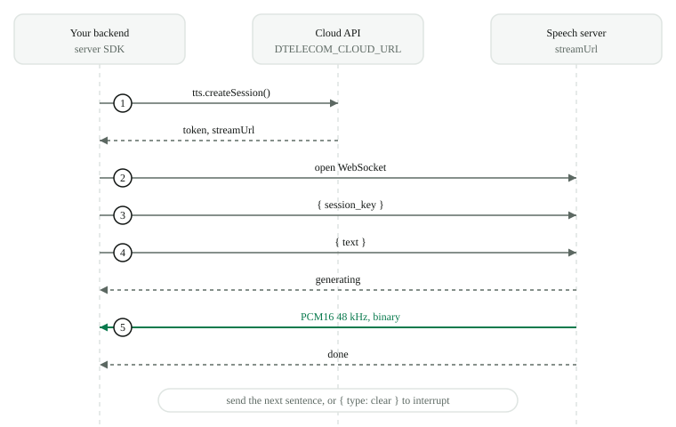

# Text-to-Speech

Two ways to turn text into speech:

| | Streaming | WAV files |
| --- | --- | --- |
| Use for | voice agents, live read-aloud | prompts, notifications, pre-rendered audio |
| You get | PCM audio frames as they are generated | a finished WAV file |
| Call style | WebSocket session | job, poll |
| Price | $0.006 per 1,000 characters (6 cr) | $0.006 per 1,000 characters (6 cr) |

## Streaming



In JavaScript, use `DtelecomTTS` from `@dtelecom/agents-js/providers`. It opens the session, reserves characters before each text, extends the session and opens a new one after a dropped connection. It works with or without a voice agent and needs Node.js 22 or newer.

```shell
npm install @dtelecom/agents-js @dtelecom/server-sdk-js @dtelecom/server-sdk-node
```

```typescript
import fs from 'fs';
import { CloudClient } from '@dtelecom/server-sdk-js';
import { DtelecomTTS } from '@dtelecom/agents-js/providers';

const cloud = new CloudClient();
const tts = new DtelecomTTS({
  cloud,
  voices: { en: { voice: 'af_heart', langCode: 'a' } },
});

async function speak(text: string, out: string) {
  const chunks: Buffer[] = [];
  for await (const pcm of tts.synthesize(text)) {
    chunks.push(pcm); // PCM16 LE, mono, 48 kHz
  }
  fs.writeFileSync(out, Buffer.concat(chunks));
  tts.close();
}

speak('Thanks for calling. How can I help you today?', 'reply.pcm');
```

For SSML use `tts.synthesizeSSML(ssml)`. To stop speech, pass an `AbortSignal` as the second argument.

The rest of this section is the WebSocket protocol, for other languages and for full control.

### 1. Open a session

A streaming session is prepaid by characters. Characters you do not use are released when the session ends.

```typescript
import { CloudClient } from '@dtelecom/server-sdk-js';

const cloud = new CloudClient();

const session = await cloud.tts.createSession({
  maxCharacters: 5000,
  voice: 'af_heart',
  language: 'en',
});
```

| Option | Description |
| --- | --- |
| `maxCharacters` | Characters the session may synthesise. |
| `voice` | Recorded for the dashboard only. The voice that is synthesised is set on the stream: in `config` of the first message, or in a text message. Otherwise the default voice, `af_heart`, speaks. |
| `language` | Language code, such as `en`. |
| `webrtcSessionId` | Links this stream to a room participant. |

### 2. Connect and speak

Output is **PCM16 little-endian, mono, 48 kHz**, in 20 ms frames.

```typescript
import fs from 'fs';
import WebSocket from 'ws';
import { CloudClient } from '@dtelecom/server-sdk-js';

const cloud = new CloudClient();

async function speak(text: string) {
  const session = await cloud.tts.createSession({ maxCharacters: text.length + 100 });
  const ws = new WebSocket(session.streamUrl); // the full WebSocket address
  const audio: Buffer[] = [];

  ws.on('open', () => {
    ws.send(JSON.stringify({ session_key: session.token })); // required first message
    ws.send(JSON.stringify({ text }));
  });
  // without this handler a failed connection crashes the process
  ws.on('error', (err) => console.error('tts socket:', err.message));

  ws.on('message', (data, isBinary) => {
    if (isBinary) {
      audio.push(data as Buffer); // play it, or forward it to a room
      return;
    }
    const msg = JSON.parse(data.toString());
    if (msg.type === 'done') {
      fs.writeFileSync('speech-48k.pcm', Buffer.concat(audio));
      ws.close();
    }
    if (msg.type === 'error') {
      console.error(msg.error, msg.message);
      ws.close();
    }
  });
}

speak('Thanks for calling. How can I help you today?');
```

Send one `{ "text": ... }` message per sentence or short paragraph and wait for `done` before sending the next. This keeps latency low and makes interruption clean.

### Messages

**You send**

| Message | Purpose |
| --- | --- |
| `{"session_key":"...","config":{...}}` | Required first message. `config` is optional: `voice`, `lang_code`, `language`, `model`, `speed`, `watermark`. |
| `{"config":{...}}` | Sent later: changes the defaults for the following text messages. |
| `{"text":"..."}` | Text to speak. May carry its own `voice`, `lang_code`, `language`, `model`, `speed` and `"input_format": "ssml"`. |
| `{"type":"clear"}` | Stop speaking now. Use it when the user interrupts the agent. |
| `{"type":"extend","session_key":"..."}` | Apply a new key after extending the session. |
| `{"type":"capabilities"}` | Ask what this server offers: engines, voices, languages, audio format. |

**You receive**

| Message | Meaning |
| --- | --- |
| `{"type":"generating","text":"..."}` | Synthesis of a text message started. With SSML it also carries `source_characters` and `spoken_characters`; with a watermark, `"watermark":"active"`. |
| binary | PCM16 audio frames. |
| `{"type":"done"}` | The text message is finished. |
| `{"type":"cleared"}` | Speech was stopped by `clear`. No `done` follows for the interrupted text. |
| `{"type":"extended","expires_in":...}` | A new key was applied. |
| `{"type":"capabilities",...}` | Answer to `capabilities`: `models` with their `voices` and `languages`, `audio`, `input_formats`, `watermark`. |
| `{"type":"error","message":"..."}` | Something went wrong. Most errors carry only a `message` text. A code in `error` comes with `session_key_used`, `character_limit_exceeded` and SSML errors, which also carry `code`, `message` and `position`. Do not branch on `error` alone. |

When a text message is longer than the characters left in the session, nothing is synthesised and you receive:

```json
{ "type": "error", "error": "character_limit_exceeded", "message": "Extend the session before sending more text" }
```

Extend the session and send the text again. The socket stays open.

A session key works for one connection. A second connection with the same key gets `session_key_used` and is closed with code 1008. After any disconnect, create a new session. When the session runs out of time you receive `{"type":"error","message":"Session token expired"}`.

### Extend a running session

A Text-to-Speech session lasts 30 minutes (`expiresAt`). `tts.extend` adds characters and another 30 minutes. Extend on your own timer, before the session ends: afterwards the call fails with 409 `session_not_extendable`.

```typescript
import type WebSocket from 'ws';
import { CloudClient } from '@dtelecom/server-sdk-js';

const cloud = new CloudClient();

async function addCharacters(ws: WebSocket, sessionId: string) {
  const { token, maxCharacters } = await cloud.tts.extend(sessionId, 5000);
  ws.send(JSON.stringify({ type: 'extend', session_key: token }));
  return maxCharacters; // new total for the session
}
```

## WAV files

Text or SSML becomes a 48 kHz mono PCM16 WAV file.

```typescript
import fs from 'fs';
import { CloudClient } from '@dtelecom/server-sdk-js';

const cloud = new CloudClient();

async function toWav(text: string, out: string) {
  let job = await cloud.wav.create({
    text,
    voice: 'af_heart',
    idempotencyKey: 'welcome-prompt-v1',
  });

  while (!['completed', 'failed', 'cancelled'].includes(job.status)) {
    await new Promise((r) => setTimeout(r, 1000));
    job = await cloud.wav.get(job.id);
  }
  if (job.status !== 'completed') throw new Error(job.error ?? job.status);

  const res = await cloud.wav.download(job.id);
  await fs.promises.writeFile(out, Buffer.from(await res.arrayBuffer()));
}

toWav('Welcome to Acme support.', 'welcome.wav');
```

| Option | Description |
| --- | --- |
| `text` | Up to 10,000 characters. |
| `idempotencyKey` | Required. Reusing it with different text fails with 409. |
| `voice` | Voice name. |
| `language` | Language code. |
| `speed` | Speaking rate, 1.0 by default. |
| `inputFormat` | `'text'` (default) or `'ssml'`. |
| `dictionary` | Pronunciation aliases, SSML only: locale, then source text, then spoken form. |
| `watermark` | Adds an audio watermark. Off by default. |

Files are kept for 24 hours. `cloud.wav.delete(id)` cancels unfinished work or deletes a finished file.

### When a WAV job is refused

Invalid SSML and other refused input fail `wav.create` with 422 `backend_rejected`. The error says what is wrong and where:

```typescript
import { CloudApiError, CloudClient } from '@dtelecom/server-sdk-js';

const cloud = new CloudClient();

try {
  await cloud.wav.create({
    text: '<speak>Hello <emphasis>there</emphasis></speak>',
    inputFormat: 'ssml',
    idempotencyKey: 'greeting-v2',
  });
} catch (err) {
  if (err instanceof CloudApiError && err.code === 'backend_rejected') {
    console.error(err.detail); // { code: 'UNSUPPORTED_TAG', message: 'Unsupported element: emphasis', position: 13 }
  }
}
```

After a temporary failure (429, 502, 503, 504), a retry with the same `idempotencyKey` runs the job again.

## Voices and languages

Two engines cover 32 languages:

| Engine | Voices | Best for |
| --- | --- | --- |
| Kokoro | 54 named voices such as `af_heart`, `bm_george`, `ef_dora` | English with many voice choices, Mandarin, Japanese |
| Supertonic | 10 styles, `F1`-`F5` and `M1`-`M5`, in 31 languages | German, Russian, Arabic and other languages; one voice across many languages |

The voice you choose selects the engine: `F1`-`F5` and `M1`-`M5` are Supertonic, every other name is Kokoro. The `model` field is optional. The default is `af_heart`. All voices and language codes are listed in [Languages and voices](languages-and-voices.md).

In a streaming text message you can switch voice per message:

```json
{ "text": "Bonjour et bienvenue.", "voice": "ff_siwis", "lang_code": "f" }
```

```json
{ "text": "Guten Tag und willkommen.", "voice": "M2", "language": "de", "model": "supertonic" }
```

## SSML, speed and watermark

Pauses, pronunciation, speaking rate, volume and an optional audio watermark are covered in [SSML and speech controls](ssml.md).

## Publishing speech into a room

To make an agent speak in a room, publish the PCM frames as an audio track from your backend. See [Server-side media](../guides/server-side-media.md), or use the ready pipeline in [Build a voice agent](../guides/voice-agent.md).

## Billing notes

- You pay for the characters you send. In a streaming session, spaces at the start and end of a text message are not billed. In SSML, the spoken text is counted. In WAV jobs plain text is counted as sent.
- In a streaming session you pay for what was synthesised, not for the reservation.
