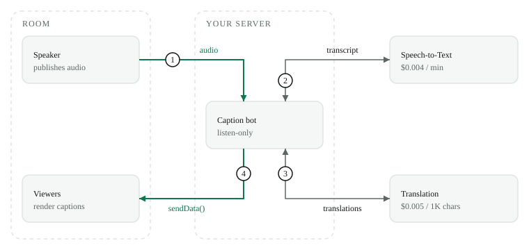

# Live captions and translation

This guide adds captions to a room. A bot on your server transcribes every speaker, optionally translates the text, and sends it to the room as data messages. Clients render the messages as captions.



## 1. The caption bot

The bot builds on the transcriber from [Server-side media](server-side-media.md). For each final transcript it translates the text and sends one message.

```shell
npm install @dtelecom/agents-js @dtelecom/server-sdk-js @dtelecom/server-sdk-node
```

`DtelecomSTT` from `@dtelecom/agents-js/providers` is the streaming Speech-to-Text client. It opens a session per speaker, extends it, and opens a new one after a dropped connection, so captions keep running for as long as the bot is in the room. It needs Node.js 22 or newer.

```typescript
import { CloudClient, DataPacket_Kind } from '@dtelecom/server-sdk-js';
import { DtelecomSTT } from '@dtelecom/agents-js/providers';
import { Room } from '@dtelecom/server-sdk-node';

const cloud = new CloudClient();
const rooms = cloud.roomService();
const stt = new DtelecomSTT({ cloud, language: 'en' });
const TARGETS = ['es', 'de']; // languages your viewers need

async function translate(text: string, target: string, key: string): Promise<string> {
  // one request takes up to 500 characters; captions are short, so one call is enough
  let r = await cloud.translate({ q: text.slice(0, 500), target, source: 'en', idempotencyKey: key });
  while (r.status === 'running') {
    await new Promise((done) => setTimeout(done, 500));
    r = await cloud.getTranslation(r.id);
  }
  return r.result?.translatedText ?? text;
}

async function main(roomName: string) {
  const { token, wsUrl, sessionId } = await cloud.createToken({
    room: roomName,
    identity: 'captions',
    grants: { canPublish: false }, // listen only
  });
  stt.setWebRTCSessionId(sessionId); // attribute the speech usage to this room session

  const room = new Room();
  await room.connect(wsUrl, token, { autoSubscribe: true });
  let n = 0;

  room.on('trackSubscribed', async (track, publication, participant) => {
    const stream = stt.createStream(); // one stream per speaker
    stream.on('error', (err) => console.error('stt:', err.message));
    stream.on('transcription', async (result) => {
      if (!result.isFinal || !result.text) return;
      try {
        const id = ++n;
        const translations: Record<string, string> = {};
        await Promise.all(
          TARGETS.map(async (lang) => {
            translations[lang] = await translate(result.text, lang, `${roomName}-cap-${id}-${lang}`);
          }),
        );

        const caption = { speaker: participant.identity, text: result.text, translations };
        const payload = new TextEncoder().encode(JSON.stringify(caption));
        await rooms.sendData(roomName, payload, DataPacket_Kind.RELIABLE, { topic: 'captions' });
      } catch (err) {
        console.error('caption failed:', err);
      }
    });

    for await (const frame of track.createStream(16000, 1)) {
      stream.sendAudio(Buffer.from(frame.data.buffer, frame.data.byteOffset, frame.data.byteLength));
    }
    await stream.close(); // the speaker left: stop paying for this stream
  });
}

main('town-hall');
```

The bot sends captions through `roomService().sendData()`: the message comes from your backend and reaches everyone in the room. The bot could also send them itself with `room.localParticipant.publishData()`; then clients see the bot as the sender. See [Server-side media](server-side-media.md#send-and-receive-data).

The bot's own room token lasts 6 hours by default. For longer events, extend it with `cloud.extendToken(sessionId, '6h')` before it expires, or the bot is removed from the room.

## 2. Show captions in the client

```typescript
import { Room, RoomEvent } from '@dtelecom/livekit-client';

function showCaptions(room: Room, language: string, el: HTMLElement) {
  room.on(RoomEvent.DataReceived, (payload, participant, kind, topic) => {
    if (topic !== 'captions') return;
    // participant is undefined here: the message comes from your backend
    const caption = JSON.parse(new TextDecoder().decode(payload));
    const text = caption.translations[language] ?? caption.text;
    el.textContent = `${caption.speaker}: ${text}`;
  });
}
```

Each viewer picks a language locally. The bot sends all translations in one message, so adding a viewer costs nothing extra.

A caption message looks like this:

```json
{
  "speaker": "alice",
  "text": "The new version ships on Friday.",
  "translations": {
    "es": "La nueva versión estará disponible el viernes.",
    "de": "Die neue Version wird am Freitag veröffentlicht."
  }
}
```

## Make it feel live

Final transcripts arrive after the speaker pauses. To show text while someone is still talking, turn on partial results and send them as a second kind of message:

- Create the client with `partials: true`: `new DtelecomSTT({ cloud, language: 'en', partials: true })`.
- Handle the `transcription_partial` event of the stream: it carries `utteranceId` and `revision`. Replace the caption with the same `utteranceId`, do not append.
- Translate only finals. Translating every partial multiplies the cost and the text keeps changing anyway.

## Cost

Per minute of speech from one speaker, with two target languages:

| Item | Usage | Cost |
| --- | --- | --- |
| Speech-to-Text | 1 minute | $0.004 |
| Translation | about 800 characters x 2 languages | $0.008 |
| Caption bot in the room | 1 participant-minute, audio | $0.0001 |
| **Total** | | **about $0.012** |

Speech-to-Text is billed per stream that is connected, so a room with three open microphones uses three streams. To save cost, open a stream when a participant unmutes and close it when they mute.

## Variations

- **Captions without translation:** drop the `translate` call. Cost falls to the Speech-to-Text rate.
- **Translated voice:** send the translated text to [Text-to-Speech](../ai/text-to-speech.md) and publish it as a separate audio track per language.
- **Transcript after the call:** keep the final transcripts in your database as they arrive. dTelecom does not store them.
- **Recordings instead of live audio:** use [File transcription](../ai/transcription.md); it is half the price and adds speaker labels.
