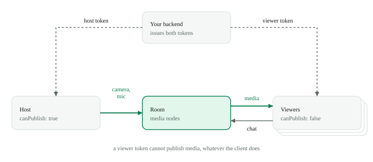

# Livestreaming

A livestream is a room where a few participants publish and everyone else only watches. The split is enforced by the token, not by your UI: a viewer's token cannot publish media, whatever the client does.



## Roles

```typescript
import { CloudClient } from '@dtelecom/server-sdk-js';

const cloud = new CloudClient();

// Host: publishes camera, microphone and screen
function hostToken(room: string, userId: string, ip: string) {
  return cloud.createToken({
    room,
    identity: userId,
    clientIp: ip,
    webhookUrls: ['https://your-app.example/api/webhook'],
  });
}

// Viewer: watches, listens and chats
function viewerToken(room: string, userId: string, ip: string) {
  return cloud.createToken({
    room,
    identity: userId,
    clientIp: ip,
    grants: { canPublish: false },
    webhookUrls: ['https://your-app.example/api/webhook'],
  });
}
```

Decide the role on your backend from your own user data. Never let the client choose it.

A token lasts 6 hours by default and 24 hours at most. For a long broadcast, extend the host's and the viewers' tokens with [`extendToken`](../rooms/tokens.md#extend-a-session) before they expire. A participant whose token expired is removed about a minute later.

## The host

```typescript
import { Room } from '@dtelecom/livekit-client';

async function goLive(wsUrl: string, token: string) {
  const room = new Room({ dynacast: true });
  await room.connect(wsUrl, token);
  await room.localParticipant.enableCameraAndMicrophone();
  return room;
}

async function shareScreen(room: Room) {
  await room.localParticipant.setScreenShareEnabled(true);
}
```

## The viewers

```typescript
import { Room, RoomEvent, Track } from '@dtelecom/livekit-client';

async function watch(wsUrl: string, token: string, stage: HTMLElement) {
  const room = new Room({ adaptiveStream: true });
  room.on(RoomEvent.TrackSubscribed, (track) => {
    if (track.kind === Track.Kind.Video || track.kind === Track.Kind.Audio) {
      stage.appendChild(track.attach());
    }
  });
  await room.connect(wsUrl, token);
  return room;
}
```

`adaptiveStream` gives each viewer the video quality that fits their player size.

## Chat

Viewers can send data messages even though they cannot publish media. See [Data messages and chat](../rooms/data.md).

## Viewer count

Count `participant_joined` and `participant_left` [webhooks](../rooms/webhooks.md) per room, or ask on demand:

```typescript
import { CloudClient } from '@dtelecom/server-sdk-js';

const rooms = new CloudClient().roomService();

async function viewerCount(room: string) {
  const participants = await rooms.listParticipants(room);
  return participants.filter((p) => !p.permission?.canPublish).length;
}
```

## Remove a viewer

```typescript
import { CloudClient } from '@dtelecom/server-sdk-js';

const rooms = new CloudClient().roomService();

await rooms.removeParticipant('launch-stream', 'viewer-831');
```

Removing and muting are backend calls. When the host clicks a button in your UI, your backend checks that the user is the host and makes the call.

## Moderate the stream

Sample the host's video and audio and send them to [Content moderation](../ai/moderation.md). One video frame every 5 seconds costs $0.006 per minute. Audio moderation adds $0.004 per minute for each participant who publishes. Viewers cost nothing to moderate.

## What it costs

The video rate applies only to video a participant publishes. A viewer who only watches is billed at the audio rate, whatever the quality of the stream.

| Participant | Per hour |
| --- | --- |
| Viewer, any stream quality | $0.006 |
| Host publishing audio only | $0.006 |
| Host publishing video up to 1080p | $0.06 |
| Host publishing 2K | $0.12 |
| Host publishing 4K | $0.24 |

Example: a 1-hour 1080p stream with one host and 200 viewers costs $0.06 for the host and 200 x $0.006 = $1.20 for the viewers, about $1.26 in total.

For steady, large audiences the [bandwidth add-on](../platform/billing.md#bandwidth-add-on) replaces per-minute billing with a fixed monthly price.

## Limits to plan for

- Up to 1,000 participants per room, on every plan.
- Every viewer is a concurrent participant. The slot is taken when the token is issued, not when the viewer connects, and an unused token holds it until it expires.
- Concurrent participants by plan: Free 10, Starter 50, Growth 200, Scale 500, Enterprise by agreement. The example with one host and 200 viewers is 201 participants, so it needs Scale. See [Limits](../platform/limits.md).

## Broadcast from OBS

OBS can publish to a room over WHIP. Your server stands between OBS and the node:

1. OBS sends its WHIP request to your endpoint with the stream key.
2. Your server checks the key and issues a publish-only token.
3. Your server answers with a 307 redirect to the node's `/whip` endpoint.

```typescript
import express from 'express';
import { CloudClient } from '@dtelecom/server-sdk-js';

const cloud = new CloudClient();
const app = express();

// your own lookup: which room and user a stream key belongs to
declare function findStream(key: string): Promise<{ room: string; userId: string } | null>;

app.post('/whip/:streamKey', async (req, res) => {
  const stream = await findStream(req.params.streamKey);
  if (!stream) return res.sendStatus(403);

  const { token, wsUrl } = await cloud.createToken({
    room: stream.room,
    identity: stream.userId,
    clientIp: req.ip,
    grants: { canSubscribe: false }, // publish only
    ttl: '12h', // must cover the whole broadcast, 24 hours at most
  });

  const whip = new URL(wsUrl.replace(/^ws/, 'http')); // the node's https address
  whip.pathname = '/whip';
  whip.searchParams.set('access_token', token);
  res.redirect(307, whip.toString());
});
```

For a broadcast longer than the `ttl`, extend the token before it expires. A complete implementation is `app/api/whip/route.ts` in [dtelecom-live](https://github.com/dTelecom/dtelecom-live).

## Example app

[dtelecom-live](https://github.com/dTelecom/dtelecom-live) is an open-source livestreaming app with host and viewer roles, chat, viewer count and OBS input. See [Examples](../reference/examples.md) for what to change when you run it with a dTelecom Cloud key.
