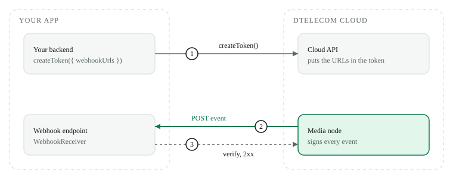

# Webhooks

Webhooks tell your backend when participants join and leave and when tracks are published. Use them to track attendance and to react when a user arrives or leaves.



## Subscribe

Webhook URLs are set per participant, in the token. There is no project-wide webhook setting.

```typescript
import { CloudClient } from '@dtelecom/server-sdk-js';

const cloud = new CloudClient();

await cloud.createToken({
  room: 'support-call',
  identity: 'user-42',
  webhookUrls: ['https://your-app.example/api/webhook'],
});
```

Up to 5 URLs per token. The rules:

- HTTPS only.
- No localhost, private or link-local addresses. Such a URL is rejected when the token is issued, with 400 `invalid_webhook_url`. For local development use a public tunnel.
- The URLs are inside the participant token, which the user can read. Do not put secrets in them.

## Events

| Event | Sent when |
| --- | --- |
| `participant_joined` | This participant joined. |
| `participant_left` | This participant left. |
| `track_published` | This participant published a track. |
| `track_unpublished` | This participant stopped publishing a track. |

Events arrive for the participant whose token carried the URL. There are no room-level events: to know that a room is empty, count `participant_left` or ask [`listParticipants`](manage-rooms.md).

## Receive and verify

Each delivery is signed by the node that sent it. `WebhookReceiver` checks that the node is a registered dTelecom node, verifies the signature and the body hash, and decodes the event. It needs the raw request body, so do not parse it as JSON first. `WebhookReceiver` needs no API key and no environment variables, only outbound internet access. It tolerates up to a minute of clock difference with the node.

```typescript
import express from 'express';
import { WebhookReceiver } from '@dtelecom/server-sdk-js';

const receiver = new WebhookReceiver();
const app = express();

app.post('/api/webhook', express.raw({ type: '*/*' }), async (req, res) => {
  try {
    const event = await receiver.receive(req.body.toString(), req.get('Authorization'));
    console.log(event.event, event.room?.name, event.participant?.identity);
    res.sendStatus(200);
  } catch {
    res.sendStatus(400); // not from a dTelecom node, or tampered with
  }
});
```

## Useful fields

| Field | Description |
| --- | --- |
| `event.event` | Event name from the table above. |
| `event.id` | Id of the event. The same for every URL the event is sent to. |
| `event.createdAt` | When it happened. |
| `event.room.name` | Room name. |
| `event.participant.identity` | The participant's identity. |
| `event.participant.rttMs` | Round-trip time to the node. Set on `participant_left`; `0` if it was not measured. |
| `event.track` | The track, on `track_published` and `track_unpublished`. |

## Tips

- Answer with a 2xx status quickly and do slow work in the background.
- Make handlers idempotent by `event.id`.
- There are no retries. Each URL gets one attempt with a 10-second timeout, and the response code is not checked. If an event matters, reconcile with the room state through `roomService()`.
- Add `webhookUrls` to every token whose events you care about. A participant whose token has no URL sends no events.
